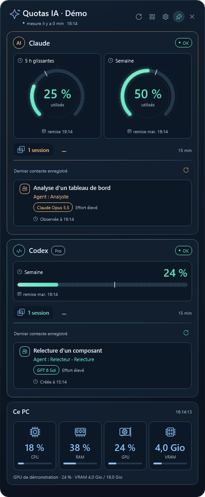

# Claude Code & Codex Quota Widget for Windows

A free, open-source Windows desktop widget for **Claude Code usage limits**, **ChatGPT Codex quotas**, observed session details, and **CPU, RAM, GPU and VRAM monitoring**. MIT licensed. Built with .NET 10 and WPF.

[Français](README.fr.md) · [Install with an AI assistant](docs/AI-INSTALL.md) · [Privacy](PRIVACY.md)



The screenshot uses entirely synthetic data, not a real account or workstation.

## What it shows

- Claude Code 5-hour and weekly subscription usage, when supplied by Claude Code.
- Codex quota windows reported by local sessions or the official Codex App Server.
- Recent observed sessions, with expandable subject, model, effort, agent metadata and creation time when available.
- Local processor, physical memory, GPU utilization and dedicated video memory.
- Independent card visibility, order, designs and dark, black, light or Windows themes.

The UI currently uses French labels. Hardware is sampled about every four seconds. Session observations are refreshed about every sixteen seconds. Quotas follow available provider events; optional direct Codex reads are throttled to ten minutes. This is **not a meter for all ChatGPT website conversations** and does not claim an exact count of agents currently working.

## Install on Windows

Download **QuotaWidget-Setup-1.0.1-win-x64.exe** from the [latest GitHub release](https://github.com/CustomDigitalServices-Kevin/claude-codex-quota-widget/releases/latest). Run it as your ordinary Windows user, choose the options and install. No compilation, .NET SDK, separate .NET runtime, Git or PowerShell 7 installation is needed. Windows 11 x64 is the supported package target.

The installer includes the .NET runtime, creates a Start menu shortcut and offers startup at sign-in. **Connect Claude Code is off by default.** Enable it only if you want the widget to configure your Claude status line. An existing status line is preserved. You still install and authenticate the provider tools separately with your own accounts.

This community installer is currently **unsigned**. Windows may display a publisher or reputation warning. The release provides SHA256 checksums; never disable Windows security protections to install it. Updates to the bundled .NET runtime require a new widget release.

For native Claude setup after installation, preview the proposed command first:

```powershell
& "$env:LOCALAPPDATA/Programs/QuotaWidget/app/quotas.exe" --configure-claude
```

After reviewing it, repeat with `--apply`. Only explicit replacement consent justifies adding `--replace-existing`. The helper preserves other settings, creates a backup, and records ownership so uninstall can undo its own integration while keeping later user changes. The native producer uses Windows PowerShell 5.1, included in Windows 11, only as a shell-compatible launcher. It does not require PowerShell 7, Bash or jq.

## Install from source

Requirements: Windows 11, PowerShell 7.5+, [.NET 10 SDK for Windows](https://dotnet.microsoft.com/download/dotnet/10.0), and Git. Install providers separately using the [Claude Code](https://code.claude.com/docs/en/setup) and [Codex](https://developers.openai.com/codex/quickstart) instructions.

Run in PowerShell 7.5+, as your ordinary Windows user:

```powershell
git clone https://github.com/CustomDigitalServices-Kevin/claude-codex-quota-widget.git
cd claude-codex-quota-widget
pwsh -NoProfile -File ./install.ps1
```

This builds the application, installs it in `%LOCALAPPDATA%\Programs\QuotaWidget`, and enables startup for the current user. It does not change provider authentication or configure Claude automatically. The source installation needs the SDK. A prebuilt framework-dependent payload, if you build one, only needs Desktop Runtime 10.

### Connect Claude Code

Preview the status line configuration without changing files:

```powershell
pwsh -NoProfile -File ./configure-claude.ps1
```

After reviewing it, apply it:

```powershell
$setup = pwsh -NoProfile -File ./configure-claude.ps1 -Apply | ConvertFrom-Json
```

An existing status line is preserved unless you explicitly add `-ReplaceExisting`. The helper backs up existing settings and prints the backup path. Keep this clone at its configured location. Start or resume Claude Code and use **your own account**. Quotas require a supported subscription and an API response. Measurement age initially stays unknown until the API duration counter changes; idle re-renders do not make an old measurement fresh.

The included PowerShell producer needs neither Bash nor `jq`. The legacy `install.ps1 -StatusLine` option only replaces an existing marked Bash block and is not the setup path for a new installation.

### Connect Codex

Existing standard Codex session logs are discovered automatically. For optional direct quota reads, use the widget's isolated profile and sign in yourself. See [the account-specific instructions](docs/AI-INSTALL.md#codex-account). No shared authentication file needs to be copied.

## Settings and removal

Use the gear to choose cards, order, background and card designs. The plus button expands session details inside a provider card. Missing metadata stays absent. A subject is a saved title, not proof of current work. The height follows the content within the screen's work area; small screens retain mouse-wheel and keyboard navigation.

For the Windows installer, use **Settings > Apps > Installed apps > Quota Widget > Uninstall**, or the Start menu uninstall shortcut. Local preferences, snapshots and the isolated Codex profile are kept. An installer-owned Claude command is removed or its prior status line restored only if the current command still belongs to this installation. User-edited commands are preserved.

For the legacy source installer, restore a previous Claude configuration using the backup path printed during setup:

```powershell
pwsh -NoProfile -File ./configure-claude.ps1 -Restore -BackupPath $setup.backup_path
pwsh -NoProfile -File ./uninstall.ps1
```

If setup created a new settings file with no backup, remove only its `statusLine` property manually, preserving any later changes. Uninstall keeps quota data and the isolated Codex profile unless the corresponding removal options are explicitly requested.

## Build and test

```powershell
dotnet build QuotaWidget.slnx -c Release -m:1 -nr:false
$env:QUOTAWIDGET_LIVE_TESTS = '0'
dotnet test QuotaWidget.slnx -c Release --no-build -m:1 -nr:false
Invoke-Pester -Path ./tests/install.Tests.ps1,./tests/ClaudeSetup.Tests.ps1
```

Tests require Pester 5.7.1. Fixtures are entirely synthetic. Provider network tests are opt-in; the disabled live test returns without assertions and is counted as passed by xUnit. WPF tests share a nonparallel collection. No runtime NuGet package is added to the desktop application.

See [packaging](packaging/README.md) for the self-contained Windows build, redistribution notices, checksums and isolated installer tests. `QuotaWidget.exe --packaging-smoke <empty-directory>` runs a clearly synthetic producer-to-details-to-WPF diagnostic and records loaded runtime paths. It does not inspect user accounts or normal settings. A controlled PATH test on a development PC is not a clean Windows VM test.

## Data sources and limits

Provider formats can change. Claude's status line is the preferred metadata source; a bounded read-only local transcript fallback can supply missing metadata. The fallback is noncontractual and may omit fields. Claude project discovery is bounded to 4096 direct directories and an exact session filename. Codex details read up to 1 MiB per session and an optional title index. Session details do not extract messages, prompts or tool contents into their results. See [PRIVACY.md](PRIVACY.md).

CPU/RAM use Windows system APIs. GPU data uses Windows PDH counters and DXGI. Unknown or unsupported counters are shown as unavailable. This is not a cross-platform app. Memory use varies with drivers and card configuration; there is no 150 MiB guarantee.

Official references: [Claude status line](https://code.claude.com/docs/en/statusline), [Codex App Server](https://developers.openai.com/codex/app-server), [Codex authentication](https://developers.openai.com/codex/auth), [Windows GPU counters](https://devblogs.microsoft.com/directx/gpus-in-the-task-manager/).

Independent community project. Not affiliated with OpenAI, Anthropic or Microsoft.
